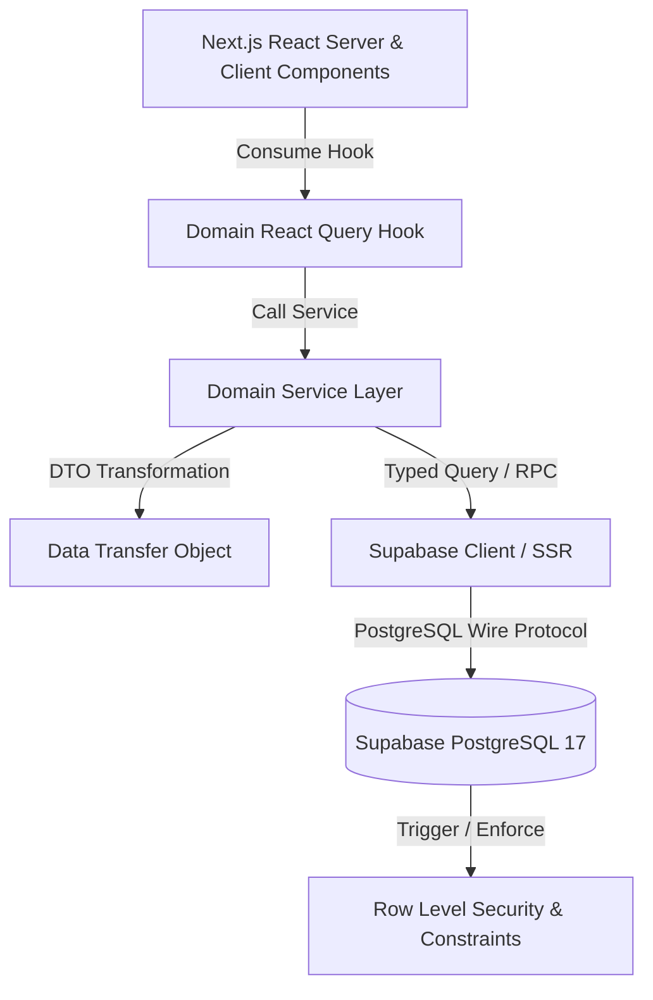
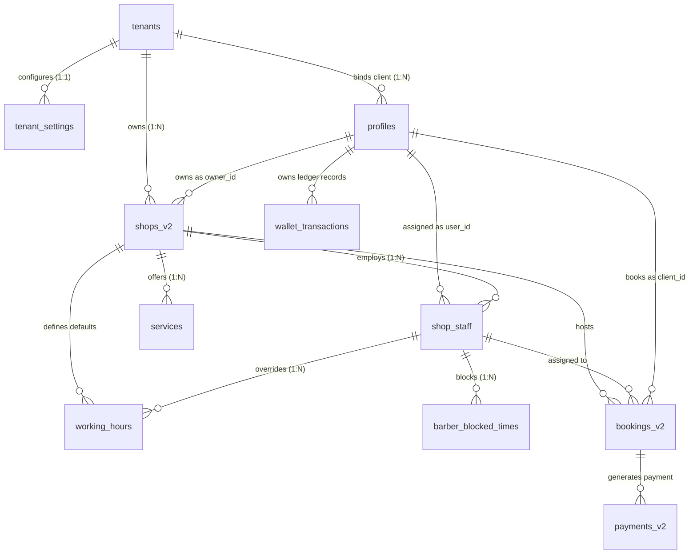
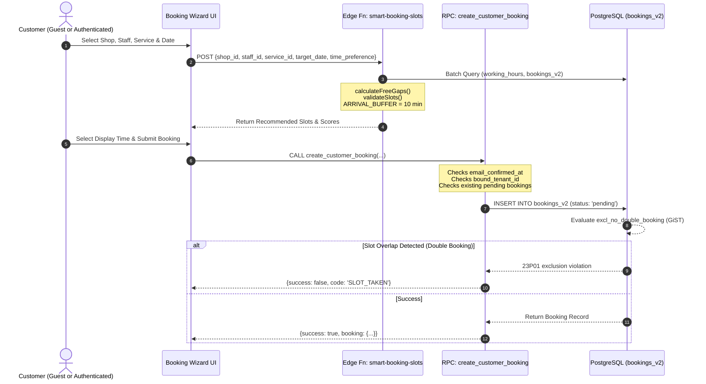
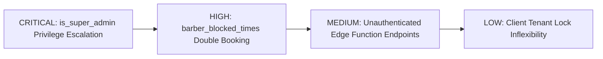

# PROJECT_MASTER_REFERENCE.md
## Barber Shop SaaS Platform — Comprehensive Discovery & Architectural Reference

> **Document Status:** Authoritative Discovery Deliverable (P0)  
> **Target Environment Verified:** Preview Branch `muilte_tenets` (`04cb2581-1ecc-4117-b9d9-59a2b4a1739d`)  
> **Parent Project:** `barber-shop` (`zxvckcdxwnwmmgcvlsql`)  
> **Branch Project Ref:** `mobkghydsjubwivjallo`  
> **Database Status:** `ACTIVE_HEALTHY` | **Branch Migration Status:** `MIGRATIONS_FAILED`  
> **Operational Stance:** Read-Only Assessment (Zero schema or migration mutations performed)

---

## 1. Project Overview & Confirmed Technology Stack

The Barber Shop SaaS platform is a multi-tenant, multi-branch appointment booking and operations management system designed for barbershops and salons. The web layer is constructed as a modern Next.js Application with role-based routing (Owner, Barber, Manager, Tenant/Client), while the backend infrastructure is completely driven by Supabase (PostgreSQL 17, Row Level Security, RPC functions, and Deno-based Edge Functions).

| Layer / Concern | Technology / Package | Confirmed Version | Verification Status |
| :--- | :--- | :--- | :--- |
| **Framework** | Next.js (App Router, Turbopack) | `16.2.9` | `[Verified]` (`package.json`) |
| **Runtime / Library** | React & React DOM | `19.2.4` | `[Verified]` (`package.json`) |
| **Language & Typings** | TypeScript (Strict mode) | `^5` | `[Verified]` (`package.json`, `tsconfig.json`) |
| **CSS & Design System** | Tailwind CSS v4, shadcn/ui, Radix UI | `@tailwindcss/postcss: ^4`, `radix-ui: ^1.6.0` | `[Verified]` (`package.json`, `components.json`) |
| **Motion & Animation** | Framer Motion | `^12.42.0` | `[Verified]` (`package.json`) |
| **Server State Management** | TanStack React Query | `^5.101.1` | `[Verified]` (`package.json`, `providers.tsx`) |
| **Client State Management** | Zustand | `^5.0.14` | `[Verified]` (`package.json`) |
| **Database & Engine** | Supabase PostgreSQL Engine | `17.6.1.113` (`eu-west-1`) | `[Verified]` (Supabase MCP `list_projects`) |
| **Client Supabase SDK** | `@supabase/ssr` & `@supabase/supabase-js` | `@supabase/ssr: ^0.12.0`, `supabase-js: ^2.108.2` | `[Verified]` (`package.json`) |
| **Cloud Messaging / Push** | Firebase SDK (Web FCM) | `^12.15.0` | `[Verified]` (`package.json`, `api/firebase-messaging-config`) |
| **Mapping & Geo** | Leaflet, React-Leaflet, Google Maps API | `leaflet: ^1.9.4`, `@react-google-maps/api: ^2.20.8` | `[Verified]` (`package.json`) |
| **Forms & Validation** | React Hook Form & Zod | `react-hook-form: ^7.80.0`, `zod: ^4.4.3` | `[Verified]` (`package.json`) |
| **Rate Limiting** | Upstash Redis (Sliding Window via Edge Fn) | `@upstash/redis: 1.28.4` | `[Verified]` (Edge Function `rate-limit-booking`) |

---

## 2. Repository Structure & Major Modules

The codebase is organized into a domain-driven structure under `src/domains/`, cleanly separating concerns from page routing in `src/app/`.

```text
d:\projets\barberdashboardCopy2/
├── src/
│   ├── app/                                # Next.js App Router Entrypoints
│   │   ├── (auth)/login/                   # Centralized login screen
│   │   ├── admin/                          # Platform Super-Admin portal
│   │   ├── api/                            # Next.js API Routes (Firebase Config)
│   │   ├── barber/                         # Barber personal portal (timeline, settings)
│   │   ├── owner/                          # Owner portal (dashboard, branches, staff, bookings)
│   │   ├── tenant/[subdomain]/             # Tenant public storefront & landing page
│   │   ├── layout.tsx & providers.tsx      # QueryClientProvider, TooltipProvider, Toaster
│   │   └── page.tsx                        # Root entry redirector
│   ├── domains/                            # Domain-Driven Core Modules
│   │   ├── auth/                           # Supabase auth handlers, login forms, profile hooks
│   │   ├── barber/                         # Barber timeline views (re-routes to shop-bookings)
│   │   ├── booking/                        # Smart booking wizard, feeds, DTOs, queue hooks
│   │   ├── branch/                         # Shop management, map pins, branch listings
│   │   ├── notifications/                  # In-app bell, web push registration
│   │   ├── owner/                          # Dashboard statistics widgets & KPI summaries
│   │   ├── services/                       # Shop service packages & price sheets
│   │   ├── staff/                          # Staff roster, working hours editor, transfers
│   │   └── tenant/                         # Subdomain resolver, branding context, tenant DTO
│   ├── lib/                                # Utilities & schemas
│   ├── proxy.ts                            # Next.js Edge Middleware for Subdomain Multi-Tenancy
│   └── shared/                             # Shared components (shadcn), Supabase client & types
├── supabase/
│   └── migrations/                         # Migration files on disk
├── desinPart1.md .. desinPart7.md          # Architectural references and wireframe guidelines
└── howWork.md                              # Code philosophy and engineering contracts
```

`[Verified]` confirmed directly from local file tree and directory inspection.

---

## 3. Architecture & Data-Flow Overview

The application enforces a strict unidirectional pipeline across all domains:



### Architectural Contracts (`[Verified]` via `howWork.md`)
1. **No Supabase calls in UI Components or Pages:** All database communications are sequestered inside `*.service.ts` files.
2. **DTO Mapping Layer:** Raw PostgreSQL column names (`client_name`, `booking_date`) are strictly converted to camelCase DTO fields (`customerName`, `bookingDate`) via `*.dto.ts` before reaching components.
3. **Backend-Driven Business Logic:** Complex operational decisions (slot availability, slot overlap avoidance, wallet deductions) are executed in PostgreSQL RPCs or Supabase Edge Functions, not on client devices.

---

## 4. Verified Database Schema & Entity Relationships

The live schema was inspected on target preview branch `mobkghydsjubwivjallo` via read-only Supabase MCP tools (`list_tables` and `execute_sql`).



### Table Definitions & Key Column Breakdown `[Verified]`

| Table Name | PK | Tenant Identifier | Foreign Keys | Key Constraints & Indexes | Row Count |
| :--- | :--- | :--- | :--- | :--- | :--- |
| **`tenants`** | `id` (uuid) | Self (`id`) | `owner_id -> profiles(id)` | `UNIQUE(subdomain)`, regex constraint on subdomain | 1 |
| **`tenant_settings`** | `id` (uuid) | `tenant_id` (uuid) | `tenant_id -> tenants(id)`, `owner_id -> auth.users(id)` | `UNIQUE(tenant_id)` | 0 |
| **`profiles`** | `id` (uuid) | `bound_tenant_id` (uuid) | `id -> auth.users(id)`, `bound_tenant_id -> tenants(id)` | `UNIQUE(email)` | 3 |
| **`shops_v2`** | `id` (uuid) | `tenant_id` (uuid) | `owner_id -> profiles(id)`, `tenant_id -> tenants(id)` | `UNIQUE(shop_code)` | 1 |
| **`shop_staff`** | `id` (uuid) | `tenant_id` (uuid) | `shop_id -> shops_v2(id)`, `user_id -> profiles(id)`, `tenant_id -> tenants(id)` | `UNIQUE(user_id, shop_id)` | 2 |
| **`services`** | `id` (uuid) | `tenant_id` (uuid) | `shop_id -> shops_v2(id)`, `tenant_id -> tenants(id)` | None | 1 |
| **`working_hours`** | `id` (uuid) | `tenant_id` (uuid) | `shop_id -> shops_v2(id)`, `staff_id -> shop_staff(id)` | `CHECK(day_of_week BETWEEN 0 AND 6)`, `CHECK(start_time < end_time)`, Partial Unique Indexes | 14 |
| **`bookings_v2`** | `id` (uuid) | `tenant_id` (uuid) | `shop_id -> shops_v2`, `staff_id -> shop_staff`, `client_id -> profiles`, `service_id -> services` | `CHECK(start_time < end_time)`, GiST Exclusion Constraint `excl_no_double_booking` | 1 |
| **`barber_blocked_times`** | `id` (uuid) | Derived (`shop_id`) | `shop_id -> shops_v2`, `staff_id -> shop_staff`, `created_by -> auth.users` | `CHECK(start_time < end_time)` | 0 |
| **`wallet_transactions`** | `id` (uuid) | None (User-level) | `user_id -> profiles(id)` | Ledger immutability | 0 |
| **`payments_v2`** | `id` (uuid) | None (via booking) | `booking_id -> bookings_v2`, `user_id -> profiles`, `wallet_tx_id -> wallet_transactions` | None | 0 |
| **`public_profiles`** | View | None | View over `profiles(id, name, avatar_url, role)` | Public read access | View |

---

## 5. Multi-Tenant Isolation Model

### 1. Web Subdomain Resolution (`proxy.ts`) `[Verified]`
In the web application, multi-tenancy is intercepted at the edge:
* `admin.[domain]` $\rightarrow$ Rewrites to `/admin` (Super-Admin platform management).
* `app.[domain]` $\rightarrow$ Resolves to Owner and Barber portal (`/owner/dashboard` or `/barber/timeline`).
* `[subdomain].[domain]` $\rightarrow$ Resolves tenant public portal (`/tenant/[subdomain]`).
* Custom headers and Supabase cookie sessions are refreshed dynamically in `proxy.ts`.

### 2. Database Multi-Tenant Isolation (`[Verified]` via MCP)
* **Tenant Assignment Trigger (`fn_auto_set_tenant_from_shop`):**  
  Attached as `BEFORE INSERT OR UPDATE` on `services`, `shop_staff`, and `working_hours`. If `NEW.shop_id` is supplied, it automatically queries `shops_v2.tenant_id` and sets `NEW.tenant_id`. If a caller supplies a conflicting `NEW.tenant_id`, the transaction is aborted with an exception.
* **Client Binding Trigger (`trg_enforce_client_tenant_binding`):**  
  Attached `BEFORE INSERT OR UPDATE` on `bookings_v2`. If the booking's `client_id` possesses a non-null `bound_tenant_id` in `profiles`, and the booking's shop belongs to a different `tenant_id`, the database raises an exception: `"حسابك مربوط بصالون محدد ولا يمكن الحجز في صالون آخر"`.
* **Tenant Auto-Binding on First Booking (`create_customer_booking` RPC):**  
  When an unbound customer (`bound_tenant_id IS NULL`) successfully books at a salon, the RPC automatically executes:
  ```sql
  UPDATE public.profiles SET bound_tenant_id = v_tenant_id WHERE id = v_uid;
  ```
  `[Verified]` directly in `pg_proc` definition.

### 3. Cross-Tenant Architectural Tradeoff `[Verified Finding]`
Because `trg_enforce_client_tenant_binding` and `create_customer_booking` enforce a strict 1-to-1 client-to-tenant relationship:
* Direct salon booking functions properly.
* An open **Marketplace Discovery** mode (where a client books at Salon A today and Salon B next week using the same account) is currently **blocked** by database triggers unless the client logs in as a guest or the profile binding is detached from a strict 1-to-1 lock.

---

## 6. Authentication, Roles, Permissions & RLS

### User Roles & Enums (`[Verified]`)
* `user_role`: `'client' | 'barber' | 'manager' | 'owner'`
* `staff_role`: `'barber' | 'manager'`
* `booking_status`: `'pending' | 'confirmed' | 'completed' | 'cancelled' | 'no_show' | 'waiting_time'`
* `payment_method_type`: `'wallet' | 'cash' | 'card'`

### Row Level Security (RLS) Matrix `[Verified]`

| Table | Policy Name | Command | Permitted Roles / Rule Summary |
| :--- | :--- | :---: | :--- |
| **`tenants`** | `tenants_select` | `SELECT` | `is_active = true OR owner_id = auth.uid() OR is_super_admin()` |
| **`tenants`** | `tenants_manage` | `ALL` | `owner_id = auth.uid() OR is_super_admin()` |
| **`tenant_settings`** | `tenant_settings_select` | `SELECT` | `true` (Publicly visible branding) |
| **`tenant_settings`** | `tenant_settings_manage` | `ALL` | `owner_id = auth.uid() OR is_super_admin()` |
| **`shops_v2`** | `shops_select` | `SELECT` | `status = 'open' OR owner_id = auth.uid() OR tenant_id IN (tenant owned) OR is_super_admin()` |
| **`shops_v2`** | `shops_manage` | `ALL` | `owner_id = auth.uid() OR tenant_id IN (tenant owned) OR is_super_admin()` |
| **`shop_staff`** | `staff_select` | `SELECT` | `is_active = true OR user_id = auth.uid() OR shop owner OR tenant owner OR is_super_admin()` |
| **`shop_staff`** | `staff_manage` | `ALL` | Shop owner or tenant owner or super-admin |
| **`services`** | `services_select` | `SELECT` | `is_active = true` or shop/tenant owner or super-admin |
| **`services`** | `services_manage` | `ALL` | Shop/tenant owner or super-admin |
| **`working_hours`** | `hours_select` | `SELECT` | Shop is open or owned, or caller is authenticated |
| **`working_hours`** | `hours_manage` | `ALL` | Shop/tenant owner or super-admin |
| **`bookings_v2`** | `bookings_select` | `SELECT` | Client owner, assigned barber, shop owner, tenant owner, or super-admin |
| **`bookings_v2`** | `bookings_insert` | `INSERT` | `auth.uid() IS NOT NULL AND (client_id = auth.uid() OR shop owner OR staff OR super-admin)` |
| **`bookings_v2`** | `bookings_client_cancel`| `UPDATE` | Client can ONLY transition `pending/confirmed` to `cancelled` |
| **`bookings_v2`** | `bookings_staff_update`| `UPDATE` | Assigned barber, shop owner, tenant owner, or super-admin |
| **`barber_blocked_times`**| `blocked_times_select` | `SELECT`| `true` (Publicly inspectable to avoid selecting blocked slots) |
| **`barber_blocked_times`**| `blocked_times_manage` | `ALL` | Assigned barber, shop owner, or super-admin |
| **`profiles`** | `profiles_select_own` | `SELECT` | `id = auth.uid() OR is_super_admin()` |
| **`profiles`** | `profiles_update_own` | `UPDATE` | `id = auth.uid() OR is_super_admin()` |
| **`profiles`** | `profiles_owner_view_staff`| `SELECT`| Owner can view profile of employed staff members |
| **`profiles`** | `profiles_client_view_staff`| `SELECT`| Client can view profile of assigned barber on their booking |
| **`wallet_transactions`**| `wallet_tx_select_own` | `SELECT`| `user_id = auth.uid()` |
| **`payments_v2`** | `payments_select` | `SELECT` | `user_id = auth.uid() OR owner of shop hosting booking` |

---

## 7. Booking Lifecycle & Business Rules



### Verified Engine Parameters `[Verified]`
* **`ARRIVAL_BUFFER`:** `10` minutes (Client display time is scheduled 10 minutes prior to operational cut start time to absorb queue variance).
* **`DEFAULT_OPERATIONAL_DURATION`:** `30` minutes default (retrieved from `services.duration_minutes`).
* **Time Periods in Smart Engine:**
  * `morning`: `06:00 - 12:00`
  * `afternoon`: `12:00 - 15:00`
  * `evening`: `15:00 - 18:00`
  * `night`: `18:00 - 23:00`
* **Double Booking Hard Enforcement:**  
  Protected by PostgreSQL constraint `excl_no_double_booking`:
  ```sql
  EXCLUDE USING gist (
      staff_id WITH =,
      booking_date WITH =,
      make_time_range(start_time, end_time) WITH &&
  ) WHERE (status NOT IN ('cancelled', 'no_show'))
  ```

---

## 8. RPCs, Edge Functions, API Routes & Integrations

### 1. Verified Public RPC Functions on Database `[Verified]`

| RPC Function Name | Security Type | Input Parameters | Output Type | Verified Purpose |
| :--- | :---: | :--- | :--- | :--- |
| **`create_customer_booking`** | `SECURITY DEFINER` | `p_shop_id, p_staff_id, p_service_id, p_booking_date, p_start_time, p_end_time, p_display_start_time` | `jsonb` | Validates client verification, tenant binding, and creates pending booking |
| **`create_booking_by_staff`** | `SECURITY DEFINER` | Staff booking payload (including client phone/name) | `jsonb` | Allows staff or owners to book appointments directly for walk-ins |
| **`block_barber_time_slot`** | `SECURITY DEFINER` | `p_shop_id, p_staff_id, p_block_date, p_start_time, p_end_time, p_reason, p_notes` | `jsonb` | Blocks off barber time while checking for active booking conflicts |
| **`bind_client_to_tenant`** | `SECURITY DEFINER` | `p_subdomain text` | `uuid` | Resolves tenant by subdomain and binds `auth.uid()` |
| **`get_owner_bookings_feed`** | `SECURITY DEFINER` | Filter parameters (`p_owner_id, p_shop_id, p_status_filter, p_date_from, p_date_to, p_page, p_page_size`) | `TABLE(...)` | Paginated feed of bookings across all branches of an owner |
| **`get_owner_dashboard_summary`** | `SECURITY DEFINER` | `p_owner_id uuid` | `TABLE(...)` | High-level metrics (revenue, total barbers, shops, upcoming counts) |
| **`get_shop_bookings`** | `SECURITY DEFINER` | `p_shop_id, p_page, p_page_size, p_status_filter, p_barber_id, p_date_from, p_date_to` | `TABLE(...)` | Paginated branch bookings used by Barber and Shop views |
| **`get_shop_today_bookings`** | `SECURITY DEFINER` | `p_shop_id uuid` | `TABLE(...)` | Fast fetch of current day's active schedule for a shop |
| **`get_shop_staff_with_profiles`** | `SECURITY DEFINER` | `p_shop_id uuid` | `TABLE(...)` | Joins staff and profile table to return active barbers |
| **`rpc_wallet_deposit`** | `SECURITY DEFINER` | `p_user_id, p_amount, p_tx_type, p_reference_id, p_description` | `jsonb` | Increments `profiles.wallet_balance` and records ledger row |
| **`rpc_wallet_deduct`** | `SECURITY DEFINER` | `p_user_id, p_amount, p_tx_type, p_reference_id, p_description` | `jsonb` | Atomically verifies balance with `FOR UPDATE` and deducts funds |
| **`update_working_hours`** | `SECURITY DEFINER` | `p_staff_id uuid, p_schedule jsonb` | `void` | Batch updates 7-day schedule for a staff member |
| **`move_barber_to_branch`** | `SECURITY DEFINER` | `p_shop_staff_id, p_new_shop_id` | `void` | Re-assigns staff member to another branch under same owner |
| **`is_super_admin`** | `SECURITY DEFINER` | None | `boolean` | Checks if `profiles.is_super_admin` is true for caller |
| **`is_tenant_owner`** | `SECURITY DEFINER` | `p_tenant_id uuid` | `boolean` | Checks if caller owns specified tenant |
| **`is_tenant_staff`** | `SECURITY DEFINER` | `p_tenant_id uuid` | `boolean` | Checks if caller is active staff under specified tenant |

### 2. Verified Active Edge Functions on Preview Branch `[Verified]`

| Slug | Version | JWT Verification | Internal Logic / Purpose |
| :--- | :---: | :---: | :--- |
| **`smart-booking-slots`** | 64 | `false` | Calculates non-conflicting available slot intervals for a barber with arrival buffers |
| **`create-staff`** | 15 | `true` | Admin endpoint to create auth user, profile, staff record, and default working hours |
| **`rate-limit-booking`** | 13 | `false` | Upstash Redis sliding window limiter (5 user attempts/min, 20 IP requests/min) |
| **`process-booking-notifications`**| 8 | `false` | Scheduled cron worker to batch-send push notifications via Firebase FCM HTTP v1 |
| **`send-test-fcm`** | 4 | `false` | Developer testing endpoint to test individual FCM device push delivery |

---

## 9. Frontend State Management & UI Conventions

1. **Server State (TanStack Query v5):**  
   Every domain maintains isolated query keys in `keys.ts` or `query-keys.ts` (e.g., `bookingKeys.all`, `bookingKeys.shop(shopId)`). Queries are invalidated deterministically on status mutations.
2. **Client State (Zustand v5):**  
   Lightweight stores manage local UI filters, active wizard steps, and selected branch tabs without duplicating database entities.
3. **Queue Time Management (`useBookingQueue`):**  
   Runs an internal 10-second ticker (`setInterval`) to calculate real-time elapsed time against booking bounds, moving expired upcoming bookings to `completed` status automatically when an active user has the tab open.
4. **Visual Guidelines:**  
   Tailwind CSS v4 with dark mode defaults, slate background palettes (`from-slate-900 via-slate-800 to-slate-950`), amber accents (`amber-500`), Framer Motion transitions, and RTL direction (`dir="rtl"`) for Arabic locale optimization.

---

## 10. Testing & Local Development Commands

### Available Package Scripts (`package.json`) `[Verified]`
```bash
npm run dev      # Next.js development server (default port 3000)
npm run build    # Production build with Next.js compiler
npm run start    # Production server runner
npm run lint     # ESLint checker (eslint ^9, eslint-config-next 16.2.9)
```

### Type Checking & Database Testing
```bash
npx tsc --noEmit           # Validate strict TypeScript types across repo
npx tsx test-db.ts         # Scratch script to verify remote Supabase RPC connectivity
```

---

## 11. Known Issues & Technical Debt

1. **Missing Notification Infrastructure in Preview Branch (`[Verified]`):**  
   The Edge Function `process-booking-notifications` is actively deployed, but its backing tables (`push_devices`, `notification_jobs`, `notification_delivery_attempts`) and RPCs (`claim_due_booking_notification_jobs`, `mark_notification_job_sent`, `mark_notification_job_failed`) do not exist in the preview database. Calling the function will fail.
2. **Missing `auto_complete_past_bookings` RPC (`[Verified]`):**  
   Referenced in `database.types.ts` from parent project, but absent on the preview database. System currently relies on frontend browser execution in `useBookingQueue` to auto-complete past appointments.
3. **Single Barber Domain Empty Stubs (`[Verified]`):**  
   Directories `src/domains/barber/services` and `src/domains/barber/hooks` are currently empty; the barber timeline page instead borrows components directly from `src/domains/booking/components/shop-bookings/`.
4. **Disconnected Barber Blocked Times (`[Verified]`):**  
   `barber_blocked_times` is populated by `block_barber_time_slot`, but `smart-booking-slots` and `create_customer_booking` do not inspect this table, allowing customer appointments to potentially land on blocked time unless explicitly mirrored into `bookings_v2`.

---

## 12. Security Findings (Classified by Severity)



### 1. CRITICAL: Unprotected `is_super_admin` Field Escalation `[RESOLVED — P0 HOTFIX APPLIED]`
* **Vulnerability:** In table `profiles`, RLS policy `profiles_update_own` allowed `auth.uid() = id` to update their profile with no column restriction. Trigger `trg_protect_profile_fields` originally only reset `role` and `wallet_balance` back to `OLD`.
* **Fix Applied & Verified:** Trigger function `fn_protect_profile_fields()` was updated directly in PostgreSQL to preserve `is_super_admin` and `bound_tenant_id`:
  ```sql
  CREATE OR REPLACE FUNCTION fn_protect_profile_fields()
  RETURNS TRIGGER AS $$
  BEGIN
      IF current_setting('role') != 'service_role' THEN
          NEW.role := OLD.role;
          NEW.wallet_balance := OLD.wallet_balance;
          NEW.is_super_admin := OLD.is_super_admin;
          NEW.bound_tenant_id := OLD.bound_tenant_id;
      END IF;
      NEW.updated_at := now();
      RETURN NEW;
  END;
  $$ LANGUAGE plpgsql SECURITY DEFINER;
  ```
* **Status:** `[Verified & Patched]` — Profile self-elevation to Super-Admin is now completely blocked at the engine level.

### 2. HIGH: Barber Blocked Time Slot Bypass `[Verified]`
* **Vulnerability:** `create_customer_booking` only checks GiST exclusion against active `bookings_v2` records. It does not inspect `barber_blocked_times`.
* **Impact:** Customers can book over periods marked as breaks or personal time off by barbers.

### 3. MEDIUM: Missing JWT Verification on Edge Functions `[Verified]`
* **Vulnerability:** `smart-booking-slots` and `rate-limit-booking` have `verify_jwt: false`.
* **Impact:** Anyone with the Supabase anon key can query slot data or consume rate limiter quotas unless protected by an upstream application gate.

### 4. LOW: Client Permanent Tenant Lockout `[Verified]`
* **Vulnerability:** Trigger `trg_enforce_client_tenant_binding` throws a hard exception if a customer with a `bound_tenant_id` tries to book at a different salon.
* **Impact:** In a multi-salon marketplace mobile app, returning customers would be unable to book at any salon other than their very first salon without manual database intervention.

---

## 13. Migration-History vs. Actual-Schema Discrepancies

A deep comparison between Supabase internal migration tracking (`supabase_migrations.schema_migrations`) and the live PostgreSQL catalog on `mobkghydsjubwivjallo` revealed the root cause of the `MIGRATIONS_FAILED` branch status:

| Item | Tracked in `schema_migrations` | Present in Live DB Catalog | Note |
| :--- | :---: | :---: | :--- |
| `001_extensions_and_enums` | Yes (`20260512201340`) | Yes | Baseline extensions |
| `002_create_profiles_table` | Yes (`20260512201356`) | Yes | Initial profiles |
| `003_create_shops_and_staff` | Yes (`20260512201412`) | Yes | Baseline shops & staff |
| `004_create_services_and_hours`| Yes (`20260512201435`) | Yes | Baseline services & hours |
| `005_create_bookings_v2` | Yes (`20260512201520`) | Yes | Baseline bookings v2 |
| `006_create_wallet_and_payments`| Yes (`20260512201541`) | Yes | Baseline wallet |
| `007_enable_rls_and_policies`| Yes (`20260512201613`) | Yes | Baseline RLS |
| `008_create_indexes` | Yes (`20260512201634`) | Yes | Baseline indexes |
| **`20261022000000_create_barber_blocked_times.sql`** | **Yes (`20261022000000`)** | **YES** | `[Reconciled & Synchronized]` |
| **`20261024000000_multi_tenant_comprehensive_fix.sql`** | **Yes (`20261024000000`)** | **YES** | `[Reconciled & Synchronized]` |
| **`push_devices` & notification tables** | **NO** | **NO** | Present in old types, missing in DB |

### Root Cause & Resolution of `MIGRATIONS_FAILED` `[Resolved]`
The target preview branch `muilte_tenets` previously contained manual DDL applications without entries in `supabase_migrations.schema_migrations`. This has now been reconciled: both `20261022000000` and `20261024000000` have been registered into `schema_migrations`, establishing a clean 10-migration verified ledger without modifying database structures.

---

## 14. Confirmed Architectural Decisions (Preliminary Agreements)

> **Notice:** These are approved architectural decisions established to guide engineering design. No schema modifications or database alterations have been executed yet for these items.

1. **Marketplace Discovery & Tenant Binding Logic (Dual-Experience Engine):**
   * **Bound Clients (`bound_tenant_id IS NOT NULL`):**  
     The Marketplace is completely **hidden/suppressed**. The client is routed directly and exclusively to their bound salon's branded experience (custom theme, salon name, specific branches, and services). No other salons will be displayed.
   * **Unbound Clients (`bound_tenant_id IS NULL`):**  
     Treated as an unbound user (including guests and new users). These users **can access the Marketplace Discovery** mode to browse, search, and view salons.
   * **System Review Gate:** Before committing final database trigger adjustments (specifically regarding `trg_enforce_client_tenant_binding` and auto-binding in `create_customer_booking`), the current system behavior will be thoroughly reviewed to ensure zero regression for single-tenant salons.

2. **Notification Subsystem Restoration (FCM / APNs Ecosystem):**
   * Rather than replacing or substituting the notification system without justification, the team decision is to **restore the existing schema and functions** (`push_devices`, `notifications`, `notification_jobs`, `notification_delivery_attempts` along with RPCs `claim_due_booking_notification_jobs`, `mark_notification_job_sent`, and `mark_notification_job_failed`).
   * A clean, non-destructive restoration migration will be drafted and reviewed prior to deployment so that the actively deployed `process-booking-notifications` Edge Function operates seamlessly.

3. **Pluggable Payment Gateway Architecture (Deferred Provider Selection):**
   * The final commercial payment gateway provider (e.g., Paymob, Stripe, Fawry) is deferred.
   * The architecture will strictly adopt an extensible **Payment Strategy Pattern** (`PaymentStrategy` interface with concrete `CashPaymentStrategy` and `WalletPaymentStrategy`). This ensures third-party payment gateways can be plugged in during post-MVP phases without requiring any refactoring of booking or checkout core modules.

---

## 15. Prioritized Next-Step Plan (Post-P0)

1. **[COMPLETED] Security Patch (P0 Hotfix):**  
   Updated `fn_protect_profile_fields()` in database to safeguard `NEW.is_super_admin` and `NEW.bound_tenant_id` against privilege escalation.
2. **[COMPLETED] Migration Reconciliation:**  
   Cleanly recorded existing out-of-band migrations into `supabase_migrations.schema_migrations` (10 total verified migrations).
3. **[READY FOR REVIEW] Notification Restoration Migration:**  
   Prepared `supabase/migrations/20261025000000_restore_notifications_subsystem.sql` to reinstate `push_devices`, `notifications`, `notification_jobs`, `notification_delivery_attempts`, triggers, and worker RPCs (`claim_due_booking_notification_jobs`, `mark_notification_job_sent`, `mark_notification_job_failed`) fully aligned with the active `process-booking-notifications` Edge Function.
4. **Integration of Blocked Times into Booking Engine:**  
   Update `smart-booking-slots` Edge Function and `create_customer_booking` RPC to incorporate `barber_blocked_times` intervals into gap calculations.
5. **Mobile React Native Scaffolding:**  
   Initialize the Expo application following the PRD and dual-mode architecture (Direct Tenant Branding vs Marketplace Discovery).
